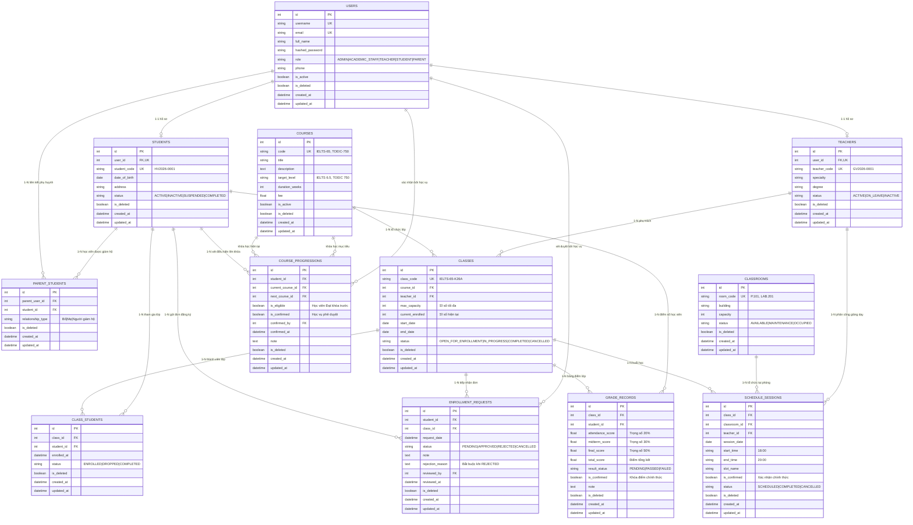

# THIẾT KẾ CƠ SỞ DỮ LIỆU TOÀN DIỆN (DATABASE ARCHITECTURE & ERD)
## Hệ thống Web Quản lý Trung tâm Ngoại ngữ (SMART-EDU LMS)

Tài liệu này trình bày chi tiết kiến trúc Cơ sở dữ liệu quan hệ (RDBMS - chuẩn 3NF), sơ đồ thực thể liên kết (ERD) và từ điển dữ liệu (Data Dictionary) cho toàn bộ 11 phân hệ và 82 chức năng nghiệp vụ của hệ thống.

---

## 1. SƠ ĐỒ THỰC THỂ QUAN HỆ (MERMAID ERD DIAGRAM)

---

## 2. CHI TIẾT TỪ ĐIỂN DỮ LIỆU (DATA DICTIONARY)

### 2.1. Bảng `users` (Tài khoản & Phân quyền)
Lưu trữ thông tin định danh và phân quyền đăng nhập cho 5 vai trò hệ thống.

| Tên cột | Kiểu dữ liệu | Ràng buộc | Mô tả | Mapping chức năng |
|---|---|---|---|---|
| `id` | `INTEGER` | Primary Key, Auto Increment | Khóa chính duy nhất của tài khoản | FR-05 |
| `username` | `VARCHAR(50)` | UNIQUE, NOT NULL, INDEX | Tên đăng nhập hệ thống | FR-01, FR-05 |
| `email` | `VARCHAR(100)` | UNIQUE, NOT NULL, INDEX | Địa chỉ email người dùng | FR-05, FR-07 |
| `full_name` | `VARCHAR(100)` | NOT NULL | Họ và tên đầy đủ | FR-07, FR-08 |
| `hashed_password` | `VARCHAR(255)` | NOT NULL | Mật khẩu được mã hóa an toàn bằng Bcrypt | FR-01, FR-06 |
| `role` | `VARCHAR(30)` | NOT NULL, DEFAULT 'STUDENT' | Vai trò: `ADMIN`, `ACADEMIC_STAFF`, `TEACHER`, `STUDENT`, `PARENT` | FR-03, FR-04 |
| `phone` | `VARCHAR(20)` | NULLABLE | Số điện thoại liên hệ | FR-07 |
| `is_active` | `BOOLEAN` | DEFAULT TRUE | Trạng thái kích hoạt tài khoản | FR-07 |
| `is_deleted` | `BOOLEAN` | DEFAULT FALSE | Cờ xóa mềm (Soft delete) | FR-10 |
| `created_at` | `DATETIME` | DEFAULT UTC NOW | Thời điểm tạo tài khoản | Hệ thống |
| `updated_at` | `DATETIME` | ON UPDATE UTC NOW | Thời điểm cập nhật cuối cùng | Hệ thống |

---

### 2.2. Bảng `courses` (Khóa học & Cấp độ mục tiêu)
Quản lý danh mục chương trình đào tạo kèm mục tiêu đầu ra cụ thể (IELTS, TOEIC).

| Tên cột | Kiểu dữ liệu | Ràng buộc | Mô tả | Mapping chức năng |
|---|---|---|---|---|
| `id` | `INTEGER` | Primary Key, Auto Increment | Mã định danh khóa học | FR-11 |
| `code` | `VARCHAR(50)` | UNIQUE, NOT NULL, INDEX | Mã khóa học (VD: `IELTS-65`, `TOEIC-750`) | FR-11, FR-15 |
| `title` | `VARCHAR(150)` | NOT NULL | Tên khóa học đầy đủ | FR-11, FR-12 |
| `description` | `TEXT` | NULLABLE | Mô tả chi tiết chương trình học | FR-11, FR-14 |
| `target_level` | `VARCHAR(100)` | NOT NULL | Chuẩn đầu ra mục tiêu (VD: "IELTS 6.5") | FR-11, FR-13 |
| `duration_weeks` | `INTEGER` | DEFAULT 12 | Thời lượng học (số tuần) | FR-11, FR-14 |
| `fee` | `FLOAT` | DEFAULT 0.0 | Mức học phí niêm yết (VNĐ) | FR-11, FR-14 |
| `is_active` | `BOOLEAN` | DEFAULT TRUE | Kích hoạt / Ngừng sử dụng khóa học | FR-16 |
| `is_deleted` | `BOOLEAN` | DEFAULT FALSE | Cờ xóa mềm khi không còn dữ liệu ràng buộc | FR-17 |

---

### 2.3. Bảng `students` (Hồ sơ Học viên)
Lưu trữ thông tin chuyên biệt cho học viên, liên kết 1-1 với tài khoản người dùng `users`.

| Tên cột | Kiểu dữ liệu | Ràng buộc | Mô tả | Mapping chức năng |
|---|---|---|---|---|
| `id` | `INTEGER` | Primary Key, Auto Increment | Khóa chính hồ sơ học viên | FR-18 |
| `user_id` | `INTEGER` | FOREIGN KEY (`users.id`), UNIQUE | Khóa ngoại liên kết 1-1 với `users` | FR-18 |
| `student_code` | `VARCHAR(50)` | UNIQUE, NOT NULL, INDEX | Mã số học viên (VD: `HV2026-0001`) | FR-18, FR-21 |
| `date_of_birth` | `DATE` | NULLABLE | Ngày tháng năm sinh | FR-18, FR-19 |
| `address` | `VARCHAR(255)` | NULLABLE | Địa chỉ thường trú | FR-18, FR-19 |
| `status` | `VARCHAR(50)` | DEFAULT 'ACTIVE' | Trạng thái: `ACTIVE`, `INACTIVE`, `SUSPENDED`, `COMPLETED` | FR-23 |
| `is_deleted` | `BOOLEAN` | DEFAULT FALSE | Cờ xóa mềm hồ sơ học viên | FR-24 |

---

### 2.4. Bảng `teachers` (Hồ sơ Giáo viên)
Lưu trữ thông tin chuyên môn, bằng cấp giảng viên, liên kết 1-1 với `users`.

| Tên cột | Kiểu dữ liệu | Ràng buộc | Mô tả | Mapping chức năng |
|---|---|---|---|---|
| `id` | `INTEGER` | Primary Key, Auto Increment | Khóa chính hồ sơ giáo viên | FR-25 |
| `user_id` | `INTEGER` | FOREIGN KEY (`users.id`), UNIQUE | Khóa ngoại liên kết 1-1 với `users` | FR-25 |
| `teacher_code` | `VARCHAR(50)` | UNIQUE, NOT NULL, INDEX | Mã giáo viên (VD: `GV2026-0001`) | FR-25, FR-28 |
| `specialty` | `VARCHAR(100)` | NOT NULL | Chuyên môn chính (IELTS Speaking & Writing) | FR-25, FR-27 |
| `degree` | `VARCHAR(100)` | NOT NULL | Trình độ học vấn / Bằng cấp giảng dạy | FR-25, FR-27 |
| `status` | `VARCHAR(50)` | DEFAULT 'ACTIVE' | Trạng thái: `ACTIVE`, `ON_LEAVE`, `INACTIVE` | FR-30 |
| `is_deleted` | `BOOLEAN` | DEFAULT FALSE | Cờ xóa mềm giáo viên | FR-31 |

---

### 2.5. Bảng `classrooms` (Phòng học & Sức chứa)
Quản lý cơ sở vật chất phòng học, phục vụ việc kiểm tra sức chứa và xếp lịch.

| Tên cột | Kiểu dữ liệu | Ràng buộc | Mô tả | Mapping chức năng |
|---|---|---|---|---|
| `id` | `INTEGER` | Primary Key, Auto Increment | Khóa chính phòng học | FR-42 |
| `room_code` | `VARCHAR(50)` | UNIQUE, NOT NULL, INDEX | Số phòng (VD: `P.101`, `LAB.201`) | FR-42, FR-46 |
| `building` | `VARCHAR(50)` | NOT NULL | Tên tòa nhà / Cơ sở | FR-42, FR-43 |
| `capacity` | `INTEGER` | NOT NULL, DEFAULT 30 | Sức chứa tối đa (số chỗ ngồi) | FR-47 |
| `status` | `VARCHAR(50)` | DEFAULT 'AVAILABLE' | Trạng thái: `AVAILABLE`, `MAINTENANCE`, `OCCUPIED` | FR-48 |
| `is_deleted` | `BOOLEAN` | DEFAULT FALSE | Cờ xóa mềm phòng học | FR-49 |

---

### 2.6. Bảng `classes` (Lớp học & Quản lý Sĩ số)
Mỗi lớp học thuộc về một khóa học, có sức chứa tối đa và theo dõi sĩ số thực tế.

| Tên cột | Kiểu dữ liệu | Ràng buộc | Mô tả | Mapping chức năng |
|---|---|---|---|---|
| `id` | `INTEGER` | Primary Key, Auto Increment | Khóa chính lớp học | FR-32 |
| `class_code` | `VARCHAR(50)` | UNIQUE, NOT NULL, INDEX | Mã lớp học (VD: `IELTS-65-K26A`) | FR-32, FR-36 |
| `course_id` | `INTEGER` | FOREIGN KEY (`courses.id`), NOT NULL | Thuộc khóa học nào | FR-32, FR-35 |
| `teacher_id` | `INTEGER` | FOREIGN KEY (`teachers.id`), NULLABLE | Giáo viên phụ trách giảng dạy chính | FR-39 |
| `max_capacity` | `INTEGER` | NOT NULL, DEFAULT 25 | Sức chứa / Sĩ số tối đa của lớp | FR-37 |
| `current_enrolled` | `INTEGER` | NOT NULL, DEFAULT 0 | Sĩ số học viên thực tế đã duyệt vào lớp | FR-37 |
| `start_date` | `DATE` | NULLABLE | Ngày khai giảng lớp học | FR-32, FR-33 |
| `end_date` | `DATE` | NULLABLE | Ngày kết thúc dự kiến | FR-32, FR-33 |
| `status` | `VARCHAR(50)` | DEFAULT 'OPEN_FOR_ENROLLMENT' | Trạng thái: `OPEN_FOR_ENROLLMENT`, `IN_PROGRESS`, `COMPLETED`, `CANCELLED` | FR-40 |
| `is_deleted` | `BOOLEAN` | DEFAULT FALSE | Cờ xóa mềm lớp học | FR-41 |

---

### 2.7. Bảng `class_students` (Danh sách Học viên trong lớp)
Bảng liên kết nhiều-nhiều (Many-to-Many) giữa `classes` và `students`.

| Tên cột | Kiểu dữ liệu | Ràng buộc | Mô tả | Mapping chức năng |
|---|---|---|---|---|
| `id` | `INTEGER` | Primary Key, Auto Increment | Khóa chính liên kết | FR-38 |
| `class_id` | `INTEGER` | FOREIGN KEY (`classes.id`), NOT NULL | Khóa ngoại tới lớp học | FR-38 |
| `student_id` | `INTEGER` | FOREIGN KEY (`students.id`), NOT NULL | Khóa ngoại tới học viên | FR-38 |
| `enrolled_at` | `DATETIME` | DEFAULT UTC NOW | Thời điểm học viên chính thức vào lớp | FR-38, FR-59 |
| `status` | `VARCHAR(50)` | DEFAULT 'ENROLLED' | Trạng thái: `ENROLLED`, `DROPPED`, `COMPLETED` | FR-38 |
| `is_deleted` | `BOOLEAN` | DEFAULT FALSE | Cờ xóa mềm | FR-38 |

---

### 2.8. Bảng `enrollment_requests` (Đăng ký & Xét duyệt lớp học)
Ghi nhận quy trình nộp đơn đăng ký lớp học và biên bản xét duyệt của nhân viên học vụ.

| Tên cột | Kiểu dữ liệu | Ràng buộc | Mô tả | Mapping chức năng |
|---|---|---|---|---|
| `id` | `INTEGER` | Primary Key, Auto Increment | Mã yêu cầu đăng ký | FR-52 |
| `student_id` | `INTEGER` | FOREIGN KEY (`students.id`), NOT NULL | Học viên gửi yêu cầu | FR-52 |
| `class_id` | `INTEGER` | FOREIGN KEY (`classes.id`), NOT NULL | Lớp học muốn đăng ký | FR-50, FR-52 |
| `request_date` | `DATETIME` | DEFAULT UTC NOW | Ngày giờ gửi đơn đăng ký | FR-53 |
| `status` | `VARCHAR(50)` | DEFAULT 'PENDING' | Trạng thái: `PENDING`, `APPROVED`, `REJECTED`, `CANCELLED` | FR-53, FR-55 |
| `note` | `TEXT` | NULLABLE | Ghi chú từ học viên khi đăng ký | FR-52 |
| `rejection_reason` | `TEXT` | NULLABLE | **Lý do từ chối (bắt buộc khi từ chối)** | FR-58 |
| `reviewed_by` | `INTEGER` | FOREIGN KEY (`users.id`), NULLABLE | Nhân viên học vụ thực hiện duyệt/từ chối | FR-57, FR-58 |
| `reviewed_at` | `DATETIME` | NULLABLE | Ngày giờ phê duyệt hoặc từ chối | FR-57, FR-58 |

---

### 2.9. Bảng `schedule_sessions` (Thời khóa biểu theo buổi)
Quản lý lịch học từng buổi, liên kết lớp học, phòng học và giáo viên phụ trách buổi đó.

| Tên cột | Kiểu dữ liệu | Ràng buộc | Mô tả | Mapping chức năng |
|---|---|---|---|---|
| `id` | `INTEGER` | Primary Key, Auto Increment | Khóa chính buổi học | FR-61 |
| `class_id` | `INTEGER` | FOREIGN KEY (`classes.id`), NOT NULL | Lớp học tổ chức buổi này | FR-61, FR-63 |
| `classroom_id` | `INTEGER` | FOREIGN KEY (`classrooms.id`), NOT NULL | Phòng học được chọn cho buổi này | FR-61, FR-62 |
| `teacher_id` | `INTEGER` | FOREIGN KEY (`teachers.id`), NOT NULL | Giảng viên đứng lớp buổi này | FR-61, FR-68 |
| `session_date` | `DATE` | NOT NULL | Ngày diễn ra buổi học | FR-61, FR-64 |
| `start_time` | `VARCHAR(10)` | NOT NULL | Giờ bắt đầu (VD: `18:00`) | FR-61, FR-65 |
| `end_time` | `VARCHAR(10)` | NOT NULL | Giờ kết thúc (VD: `20:00`) | FR-61, FR-65 |
| `slot_name` | `VARCHAR(50)` | DEFAULT 'Ca tối' | Tên ca học | FR-61 |
| `is_confirmed` | `BOOLEAN` | DEFAULT FALSE | Xác nhận thời khóa biểu chính thức | FR-66 |
| `status` | `VARCHAR(50)` | DEFAULT 'SCHEDULED' | Trạng thái: `SCHEDULED`, `COMPLETED`, `CANCELLED` | FR-67 |

---

### 2.10. Bảng `grade_records` (Quản lý Điểm & Đánh giá)
Lưu trữ bảng điểm thành phần, điểm tổng kết và xếp loại hoàn thành khóa học.

| Tên cột | Kiểu dữ liệu | Ràng buộc | Mô tả | Mapping chức năng |
|---|---|---|---|---|
| `id` | `INTEGER` | Primary Key, Auto Increment | Khóa chính bản ghi điểm | FR-70 |
| `class_id` | `INTEGER` | FOREIGN KEY (`classes.id`), NOT NULL | Lớp học được chấm điểm | FR-69 |
| `student_id` | `INTEGER` | FOREIGN KEY (`students.id`), NOT NULL | Học viên nhận điểm | FR-69, FR-72 |
| `attendance_score` | `FLOAT` | DEFAULT 0.0, CHECK [0, 10] | Điểm chuyên cần (trọng số 20%) | FR-70, FR-73 |
| `midterm_score` | `FLOAT` | DEFAULT 0.0, CHECK [0, 10] | Điểm thi giữa kỳ (trọng số 30%) | FR-70, FR-73 |
| `final_score` | `FLOAT` | DEFAULT 0.0, CHECK [0, 10] | Điểm thi cuối kỳ (trọng số 50%) | FR-70, FR-73 |
| `total_score` | `FLOAT` | DEFAULT 0.0, CHECK [0, 10] | Điểm tổng kết tự động tính | FR-74 |
| `result_status` | `VARCHAR(50)` | DEFAULT 'PENDING' | Xếp loại: `PENDING`, `PASSED`, `FAILED` | FR-74, FR-75 |
| `is_confirmed` | `BOOLEAN` | DEFAULT FALSE | Khóa bảng điểm chính thức | FR-76, FR-77 |
| `note` | `TEXT` | NULLABLE | Nhận xét chi tiết của giảng viên | FR-71 |

---

### 2.11. Bảng `course_progressions` (Lộ trình Chuyển khóa học)
Kiểm tra điều kiện tiên quyết và xác nhận cho phép học viên đăng ký khóa học cấp cao hơn.

| Tên cột | Kiểu dữ liệu | Ràng buộc | Mô tả | Mapping chức năng |
|---|---|---|---|---|
| `id` | `INTEGER` | Primary Key, Auto Increment | Mã bản ghi chuyển khóa | FR-78 |
| `student_id` | `INTEGER` | FOREIGN KEY (`students.id`), NOT NULL | Học viên cần xét chuyển khóa | FR-78 |
| `current_course_id` | `INTEGER` | FOREIGN KEY (`courses.id`), NOT NULL | Khóa học đã/đang học | FR-78 |
| `next_course_id` | `INTEGER` | FOREIGN KEY (`courses.id`), NOT NULL | Khóa học mục tiêu tiếp theo | FR-78, FR-80 |
| `is_eligible` | `BOOLEAN` | DEFAULT FALSE | Đủ điều kiện (đã Đạt chuẩn đầu ra khóa trước) | FR-78 |
| `is_confirmed` | `BOOLEAN` | DEFAULT FALSE | Nhân viên học vụ xác nhận duyệt lên khóa | FR-79 |
| `confirmed_by` | `INTEGER` | FOREIGN KEY (`users.id`), NULLABLE | Học vụ thực hiện xác nhận | FR-79 |
| `confirmed_at` | `DATETIME` | NULLABLE | Thời điểm xác nhận | FR-79 |
| `note` | `TEXT` | NULLABLE | Ghi chú kết quả thẩm định | FR-78 |

---

### 2.12. Bảng `parent_students` (Liên kết Phụ huynh - Học viên)
Phục vụ cổng thông tin phụ huynh giám hộ học viên.

| Tên cột | Kiểu dữ liệu | Ràng buộc | Mô tả | Mapping chức năng |
|---|---|---|---|---|
| `id` | `INTEGER` | Primary Key, Auto Increment | Khóa chính liên kết | FR-81 |
| `parent_user_id` | `INTEGER` | FOREIGN KEY (`users.id`), NOT NULL | Tài khoản của phụ huynh | FR-81 |
| `student_id` | `INTEGER` | FOREIGN KEY (`students.id`), NOT NULL | Hồ sơ học viên được giám hộ | FR-81, FR-82 |
| `relationship_type` | `VARCHAR(50)` | DEFAULT 'Phụ huynh' | Mối quan hệ: Bố, Mẹ, Người giám hộ | FR-81 |

---

## 3. CÁC RÀNG BUỘC TOÀN VẸN DỮ LIỆU CHÍNH (BUSINESS CONSTRAINTS)

1. **Ràng buộc Xung đột Thời khóa biểu (Unique Conflict Rule):**
   - Không được phép có hai bản ghi trong `schedule_sessions` có cùng `session_date`, cùng `classroom_id` (hoặc cùng `teacher_id`) mà khoảng thời gian $(start_1, end_1)$ giao với $(start_2, end_2)$ ngoại trừ bản ghi có `status = 'CANCELLED'`.
2. **Ràng buộc Sĩ số Lớp học (Capacity Constraint):**
   - $current\_enrolled \le max\_capacity$. Khi $current\_enrolled = max\_capacity$, hệ thống tự động khóa không cho duyệt thêm yêu cầu đăng ký mới.
3. **Ràng buộc Điểm số Hợp lệ (Score Range Constraint):**
   - Tất cả các trường điểm ($attendance$, $midterm$, $final$, $total$) bắt buộc phải nằm trong miền giá trị $[0.0, 10.0]$.

