# THIẾT KẾ CƠ SỞ DỮ LIỆU TOÀN DIỆN (DATABASE ARCHITECTURE & DATA DICTIONARY)
## Hệ thống Web Quản lý Đào tạo & Trung tâm Ngoại ngữ (SMART-EDU LMS)

Tài liệu này chuẩn hóa toàn bộ kiến trúc Cơ sở dữ liệu quan hệ (RDBMS - chuẩn 3NF), mô hình dữ liệu vật lý (Physical Schema), sơ đồ thực thể liên kết (ERD) và từ điển dữ liệu (Data Dictionary) cho toàn bộ 11 phân hệ, 82 chức năng nghiệp vụ (FR-01 đến FR-82) cùng các quy tắc bảo mật và toàn vẹn dữ liệu mới nhất (BUG-01, BUG-02, BUG-03, OBS-01).

---

## 1. TỔNG QUAN KIẾN TRÚC CƠ SỞ DỮ LIỆU

- **Hệ quản trị CSDL hỗ trợ:** SQLite (môi trường Local Dev/QA Test) & PostgreSQL 16 (Staging / Production).
- **Chuẩn thiết kế:** Chuẩn hóa bậc 3 (3NF), khóa ngoại có ràng buộc toàn vẹn tham chiếu, cờ xóa mềm (`DaXoa` / `is_deleted`) trên tất cả bảng chính, tự động ghi nhận thời gian tạo (`NgayTao` / `created_at`) và cập nhật (`NgayCapNhat` / `updated_at`).
- **Chiến lược định danh (Dual Naming Strategy):**
  - **Tên bảng & cột vật lý trong CSDL (Database Physical Layer):** Sử dụng danh xưng Tiếng Việt chuẩn hóa theo thiết kế DrawIO hệ thống (VD: `NGUOI_DUNG`, `LOP_HOC`, `BANG_DIEM`, `DON_THU`,...).
  - **Lớp thực thể mã nguồn (ORM / Backend Service Layer):** Ánh xạ tương ứng sang SQLAlchemy Models và Pydantic Schemas theo chuẩn tiếng Anh (`User`, `Class`, `GradeRecord`, `Ticket`,...).

---

## 2. BẢNG TỔNG HỢP ÁNH XẠ THỰC THỂ (15 BẢNG)

| STT | Bảng vật lý (DB Table) | SQLAlchemy Model | Mô tả nghiệp vụ | Phân hệ tương ứng |
|:---:|:---|:---|:---|:---|
| 1 | `NGUOI_DUNG` | `User` | Tài khoản, vai trò, bảo mật khóa tạm thời & OTP | Auth & Phân quyền |
| 2 | `KHOA_HOC` | `Course` | Chương trình đào tạo, chuẩn đầu ra mục tiêu, học phí | Quản lý Khóa học |
| 3 | `HOC_VIEN` | `Student` | Hồ sơ cá nhân học viên (1-1 với `User`) | Quản lý Học viên |
| 4 | `GIANG_VIEN` | `Teacher` | Hồ sơ chuyên môn, học vị giảng viên (1-1 với `User`) | Quản lý Giảng viên |
| 5 | `PHONG_HOC` | `Classroom` | Phòng học, tòa nhà, sức chứa chỗ ngồi | Cơ sở vật chất |
| 6 | `LOP_HOC` | `Class` | Lớp học, sĩ số tối đa/thực tế, ngày bắt đầu/kết thúc | Quản lý Lớp học |
| 7 | `HOC_VIEN_LOP_HOC` | `ClassStudent` | Học viên thuộc lớp (Hỗ trợ trạng thái `TRANSFERRED`) | Quản lý Lớp học |
| 8 | `YEU_CAU_DANG_KY` | `EnrollmentRequest` | Yêu cầu ghi danh lớp học, lý do từ chối | Đăng ký & Ghi danh |
| 9 | `BUOI_HOC` | `ScheduleSession` | Lịch học theo buổi, phân công phòng & giáo viên | Thời khóa biểu |
| 10 | `BANG_DIEM` | `GradeRecord` | Bảng điểm thành phần, khóa sổ chính thức | Điểm số & Đánh giá |
| 11 | `LICHSU_KHOA_DIEM` | `GradeLockHistory` | Audit trail lịch sử khóa/mở khóa sổ điểm | Quản lý Điểm & Kiểm toán |
| 12 | `TIEN_TRINH_KHOA_HOC`| `CourseProgression`| Xét điều kiện tiên quyết và chuyển khóa học mục tiêu| Lộ trình Học tập |
| 13 | `PHU_HUYNH_HOC_VIEN`| `ParentStudent` | Liên kết tài khoản phụ huynh với học viên giám hộ | Cổng Phụ huynh |
| 14 | `DON_THU` | `Ticket` | Đơn khiếu nại điểm, yêu cầu mở khóa, chuyển lớp | Giao tiếp & Khiếu nại |
| 15 | `DON_THU_PHAN_HOI` | `TicketMessage` | Lịch sử trao đổi, phản hồi trong từng đơn thư | Giao tiếp & Khiếu nại |

---

## 3. SƠ ĐỒ THỰC THỂ LIÊN KẾT TOÀN DIỆN (MERMAID ERD & PLANTUML)

> Xem file lược đồ PlantUML hoàn chỉnh tại: [`docs/DATABASE_SCHEMA.puml`](./DATABASE_SCHEMA.puml)

```mermaid
erDiagram
    NGUOI_DUNG ||--o| HOC_VIEN : "1-1 hồ sơ học viên"
    NGUOI_DUNG ||--o| GIANG_VIEN : "1-1 hồ sơ giảng viên"
    NGUOI_DUNG ||--o{ PHU_HUYNH_HOC_VIEN : "1-N liên kết phụ huynh"
    HOC_VIEN ||--o{ PHU_HUYNH_HOC_VIEN : "1-N học viên được giám hộ"
    
    KHOA_HOC ||--o{ LOP_HOC : "1-N tổ chức lớp"
    GIANG_VIEN ||--o{ LOP_HOC : "1-N chủ nhiệm / phụ trách chính"
    
    LOP_HOC ||--o{ HOC_VIEN_LOP_HOC : "1-N danh sách lớp"
    HOC_VIEN ||--o{ HOC_VIEN_LOP_HOC : "1-N tham gia lớp"
    
    HOC_VIEN ||--o{ YEU_CAU_DANG_KY : "1-N nộp đơn ghi danh"
    LOP_HOC ||--o{ YEU_CAU_DANG_KY : "1-N tiếp nhận ghi danh"
    NGUOI_DUNG ||--o{ YEU_CAU_DANG_KY : "xét duyệt bởi học vụ"
    
    LOP_HOC ||--o{ BUOI_HOC : "1-N buổi học trong khóa"
    PHONG_HOC ||--o{ BUOI_HOC : "1-N bố trí phòng học"
    GIANG_VIEN ||--o{ BUOI_HOC : "1-N phân công đứng lớp"
    
    LOP_HOC ||--o{ BANG_DIEM : "1-N sổ điểm lớp"
    HOC_VIEN ||--o{ BANG_DIEM : "1-N kết quả học tập"
    
    LOP_HOC ||--o{ LICHSU_KHOA_DIEM : "1-N lịch sử đóng/mở sổ"
    NGUOI_DUNG ||--o{ LICHSU_KHOA_DIEM : "người thực hiện thao tác"
    
    HOC_VIEN ||--o{ TIEN_TRINH_KHOA_HOC : "1-N hồ sơ lộ trình"
    KHOA_HOC ||--o{ TIEN_TRINH_KHOA_HOC : "khóa học hiện tại"
    KHOA_HOC ||--o{ TIEN_TRINH_KHOA_HOC : "khóa học mục tiêu"
    NGUOI_DUNG ||--o{ TIEN_TRINH_KHOA_HOC : "xác nhận bởi học vụ"
    
    NGUOI_DUNG ||--o{ DON_THU : "người gửi đơn"
    NGUOI_DUNG ||--o{ DON_THU : "người nhận chỉ định"
    LOP_HOC ||--o{ DON_THU : "đơn liên quan đến lớp"
    
    DON_THU ||--o{ DON_THU_PHAN_HOI : "1-N trao đổi phản hồi"
    NGUOI_DUNG ||--o{ DON_THU_PHAN_HOI : "người gửi tin nhắn"

    NGUOI_DUNG {
        int MaNguoiDung PK
        string TenDangNhap UK
        string Email "UK phối hợp với VaiTro"
        string HoTen
        string MatKhau "Hashed Bcrypt"
        string VaiTro "ADMIN|ACADEMIC_STAFF|TEACHER|STUDENT|PARENT"
        string SoDienThoai
        string AnhDaiDien
        boolean TrangThai "Kích hoạt"
        int SoLanDangNhapSai "Bảo mật khóa tạm thời"
        datetime ThoiGianKhoa "Khóa 15 phút nếu >= 5 lần sai"
        string MaXacThucOTP "Quên mật khẩu"
        datetime HanXacThucOTP
        datetime NgayTao
        datetime NgayCapNhat
        boolean DaXoa
    }

    KHOA_HOC {
        int MaKhoaHoc PK
        string MaSoKhoaHoc UK "IELTS-65, TOEIC-750"
        string TenKhoaHoc
        text MoTa
        string TrinhDoMucTieu "IELTS 6.5, TOEIC 750, CEFR B1"
        int ThoiLuongTuan "Mặc định 12 tuần"
        float HocPhi
        boolean TrangThai "Đang tuyển sinh"
        datetime NgayTao
        datetime NgayCapNhat
        boolean DaXoa
    }

    HOC_VIEN {
        int MaHocVien PK
        int MaNguoiDung FK,UK
        string MaSoHocVien UK "HV2026-0001"
        date NgaySinh
        string DiaChi
        string TrangThai "ACTIVE|INACTIVE|SUSPENDED|COMPLETED"
        datetime NgayTao
        datetime NgayCapNhat
        boolean DaXoa
    }

    GIANG_VIEN {
        int MaGiangVien PK
        int MaNguoiDung FK,UK
        string MaSoGiangVien UK "GV2026-0001"
        string ChuyenMon "IELTS Speaking & Writing"
        string HocVi "Thạc sĩ, Cử nhân"
        string TrangThai "ACTIVE|ON_LEAVE|INACTIVE"
        datetime NgayTao
        datetime NgayCapNhat
        boolean DaXoa
    }

    PHONG_HOC {
        int MaPhongHoc PK
        string MaSoPhong UK "P.101, LAB.201"
        string ToaNha "Tòa nhà A"
        int SucChua "Số chỗ ngồi"
        string TrangThai "AVAILABLE|MAINTENANCE|OCCUPIED"
        datetime NgayTao
        datetime NgayCapNhat
        boolean DaXoa
    }

    LOP_HOC {
        int MaLopHoc PK
        string MaSoLop UK "IELTS-65-K26A"
        int MaKhoaHoc FK
        int MaGiangVien FK
        int SiSoToiDa "Sức chứa tối đa (mặc định 25)"
        int SiSoHienTai "Sĩ số thực tế"
        date NgayMoLop "Thời điểm mở ghi danh"
        date NgayBatDau "Khai giảng thực tế"
        date NgayKetThuc "Bế giảng lớp"
        string TrangThai "OPEN_FOR_ENROLLMENT|IN_PROGRESS|COMPLETED|CANCELLED"
        boolean MoKhoaDiemThuCong "Cờ mở khóa điểm sau khi kết thúc"
        datetime NgayTao
        datetime NgayCapNhat
        boolean DaXoa
    }

    HOC_VIEN_LOP_HOC {
        int MaHV_LH PK
        int MaLopHoc FK
        int MaHocVien FK
        datetime NgayVaoLop
        string TrangThaiHoc "ENROLLED|DROPPED|COMPLETED|TRANSFERRED"
        datetime NgayTao
        datetime NgayCapNhat
        boolean DaXoa "Giữ False khi chuyển lớp để lưu lịch sử"
    }

    YEU_CAU_DANG_KY {
        int MaYeuCau PK
        int MaHocVien FK
        int MaLopHoc FK
        datetime NgayYeuCau
        string TrangThai "PENDING|APPROVED|REJECTED|CANCELLED"
        text GhiChu
        text LyDoTuChoi "Bắt buộc khi REJECTED"
        int MaNguoiDuyet FK
        datetime NgayDuyet
        datetime NgayTao
        datetime NgayCapNhat
        boolean DaXoa
    }

    BUOI_HOC {
        int MaBuoiHoc PK
        int MaLopHoc FK
        int MaPhongHoc FK
        int MaGiangVien FK
        date NgayHoc "Từ NgayBatDau đến NgayKetThuc"
        string GioBatDau "18:00"
        string GioKetThuc "20:00"
        string CaHoc "Ca tối (18:00 - 20:00)"
        boolean DaXacNhan "Xác nhận TKB áp dụng"
        string TrangThai "SCHEDULED|COMPLETED|CANCELLED"
        datetime NgayTao
        datetime NgayCapNhat
        boolean DaXoa
    }

    BANG_DIEM {
        int MaBangDiem PK
        int MaLopHoc FK
        int MaHocVien FK
        float DiemChuyenCan "Trọng số 20% (0.0-10.0)"
        float DiemGiuaKy "Trọng số 30% (0.0-10.0)"
        float DiemCuoiKy "Trọng số 50% (0.0-10.0)"
        float DiemTongKet "Điểm tổng kết chuẩn hóa"
        string KetQua "PENDING|PASSED|FAILED"
        boolean DaKhoaSo "Khóa điểm chính thức (is_confirmed)"
        text GhiChu
        datetime NgayTao
        datetime NgayCapNhat
        boolean DaXoa "Bảo toàn False khi chuyển lớp"
    }

    LICHSU_KHOA_DIEM {
        int MaLichSu PK
        int MaLopHoc FK
        string HanhDong "LOCK|UNLOCK|AUTO_LOCK"
        int MaNguoiThucHien FK
        datetime ThoiGian
        text LyDo
        datetime NgayTao
        datetime NgayCapNhat
        boolean DaXoa
    }

    TIEN_TRINH_KHOA_HOC {
        int MaTienTrinh PK
        int MaHocVien FK
        int MaKhoaHocHienTai FK
        int MaKhoaHocTiepTheo FK
        boolean DuDieuKien "Học viên đã PASS khóa trước"
        boolean DaXacNhan "Học vụ xác nhận"
        int MaNguoiXacNhan FK
        datetime NgayXacNhan
        text GhiChu
        datetime NgayTao
        datetime NgayCapNhat
        boolean DaXoa
    }

    PHU_HUYNH_HOC_VIEN {
        int MaPH_HV PK
        int MaNguoiDung_PH FK
        int MaHocVien FK
        string QuanHe "Bố|Mẹ|Người giám hộ"
        datetime NgayTao
        datetime NgayCapNhat
        boolean DaXoa
    }

    DON_THU {
        int MaDon PK
        string MaSoDon UK "KN-202611-001 / YC-202611-001"
        string LoaiDon "COMPLAINT|REQUEST"
        int MaNguoiGui FK
        int MaNguoiNhan FK "Chỉ định người nhận cụ thể"
        string VaiTroNguoiNhan "Hoặc broadcast tới Role"
        string LinhVuc "GRADE|SCHEDULE|ENROLLMENT|OTHER"
        int MaLopHoc FK
        string TieuDe
        text NoiDung
        string TrangThai "PENDING|PROCESSING|RESOLVED|CLOSED"
        datetime HanChotKhieuNai "Hạn chót cho khiếu nại điểm"
        datetime NgayTao
        datetime NgayCapNhat
        boolean DaXoa
    }

    DON_THU_PHAN_HOI {
        int MaPhanHoi PK
        int MaDon FK
        int MaNguoiGui FK
        text NoiDung
        datetime NgayTao
        datetime NgayCapNhat
        boolean DaXoa
    }
```



---

## 4. CHI TIẾT TỪ ĐIỂN DỮ LIỆU (DATA DICTIONARY)

### 4.1. Bảng `NGUOI_DUNG` (`users`) - Tài khoản & Phân quyền
Lưu trữ thông tin người dùng, mật khẩu mã hóa Bcrypt, bảo mật khóa tạm thời, mã OTP và phân quyền 5 vai trò.

| Tên cột vật lý | Tên thuộc tính ORM | Kiểu dữ liệu | Ràng buộc | Mô tả nghiệp vụ | Mapping chức năng |
|:---|:---|:---|:---|:---|:---|
| `MaNguoiDung` | `id` | `INTEGER` | PK, Auto Increment | Định danh tài khoản duy nhất | FR-05 |
| `TenDangNhap` | `username` | `VARCHAR(50)` | UNIQUE, NOT NULL, INDEX | Tên đăng nhập hệ thống | FR-01, FR-05 |
| `Email` | `email` | `VARCHAR(100)` | NOT NULL, INDEX | Email liên hệ | FR-05, FR-07 |
| `HoTen` | `full_name` | `VARCHAR(100)` | NOT NULL | Họ và tên đầy đủ | FR-07, FR-08 |
| `MatKhau` | `hashed_password` | `VARCHAR(255)` | NOT NULL | Mật khẩu băm an toàn Bcrypt | FR-01, FR-06 |
| `VaiTro` | `role` | `VARCHAR(30)` | NOT NULL, DEFAULT 'STUDENT' | `ADMIN`, `ACADEMIC_STAFF`, `TEACHER`, `STUDENT`, `PARENT` | FR-03, FR-04 |
| `SoDienThoai` | `phone` | `VARCHAR(20)` | NULLABLE | Số điện thoại liên lạc | FR-07 |
| `AnhDaiDien` | `avatar_url` | `VARCHAR(500)` | NULLABLE | Đường dẫn ảnh đại diện avatar | FR-07 |
| `TrangThai` | `is_active` | `BOOLEAN` | DEFAULT TRUE | Trạng thái hoạt động tài khoản | FR-07 |
| `SoLanDangNhapSai`| `failed_login_attempts`| `INTEGER` | DEFAULT 0, NOT NULL | Số lần nhập sai mật khẩu liên tiếp | FR-02 (Lockout) |
| `ThoiGianKhoa` | `locked_until` | `DATETIME` | NULLABLE | Khóa tạm thời 15 phút nếu sai $\ge 5$ lần | FR-02 (Lockout) |
| `MaXacThucOTP` | `reset_token` | `VARCHAR(100)`| NULLABLE | Mã OTP cấp quyền đặt lại mật khẩu | FR-06 (Forgot Pass) |
| `HanXacThucOTP` | `reset_token_expires_at`| `DATETIME` | NULLABLE | Thời hạn hiệu lực của mã OTP | FR-06 (Forgot Pass) |
| `NgayTao` | `created_at` | `DATETIME` | DEFAULT UTC NOW | Thời điểm tạo tài khoản | Hệ thống |
| `NgayCapNhat` | `updated_at` | `DATETIME` | ON UPDATE UTC NOW | Thời điểm cập nhật cuối cùng | Hệ thống |
| `DaXoa` | `is_deleted` | `BOOLEAN` | DEFAULT FALSE | Cờ xóa mềm (Soft delete) | FR-10 |

> **Ràng buộc đặc biệt:** `UniqueConstraint("Email", "VaiTro")` cho phép một cá nhân dùng chung email cho cả vai trò Phụ huynh (`PARENT`) và Học vụ/Giảng viên/Admin mà không bị xung đột.

---

### 4.2. Bảng `KHOA_HOC` (`courses`) - Danh mục Khóa học
Quản lý chương trình học, chuẩn đầu ra (IELTS, TOEIC, CEFR) và thời lượng chuẩn hóa.

| Tên cột vật lý | Tên thuộc tính ORM | Kiểu dữ liệu | Ràng buộc | Mô tả nghiệp vụ | Mapping chức năng |
|:---|:---|:---|:---|:---|:---|
| `MaKhoaHoc` | `id` | `INTEGER` | PK, Auto Increment | Mã định danh khóa học | FR-11 |
| `MaSoKhoaHoc` | `code` | `VARCHAR(50)` | UNIQUE, NOT NULL, INDEX | Mã khóa học (VD: `IELTS-65`, `TOEIC-750`) | FR-11, FR-15 |
| `TenKhoaHoc` | `title` | `VARCHAR(150)` | NOT NULL | Tên khóa học đầy đủ | FR-11, FR-12 |
| `MoTa` | `description` | `TEXT` | NULLABLE | Nội dung chi tiết chương trình | FR-11, FR-14 |
| `TrinhDoMucTieu`| `target_level` | `VARCHAR(100)` | NOT NULL | Chuẩn đầu ra mục tiêu (VD: "IELTS 6.5") | FR-11, FR-13 |
| `ThoiLuongTuan` | `duration_weeks` | `INTEGER` | DEFAULT 12 | Thời lượng học chuẩn (số tuần) | FR-11, FR-14 |
| `HocPhi` | `fee` | `FLOAT` | DEFAULT 0.0 | Mức học phí niêm yết (VNĐ) | FR-11, FR-14 |
| `TrangThai` | `is_active` | `BOOLEAN` | DEFAULT TRUE | Khóa học đang mở / tạm ngưng | FR-16 |
| `NgayTao` | `created_at` | `DATETIME` | DEFAULT UTC NOW | Ngày tạo | Hệ thống |
| `NgayCapNhat` | `updated_at` | `DATETIME` | ON UPDATE UTC NOW | Ngày cập nhật | Hệ thống |
| `DaXoa` | `is_deleted` | `BOOLEAN` | DEFAULT FALSE | Cờ xóa mềm | FR-17 |

---

### 4.3. Bảng `HOC_VIEN` (`students`) - Hồ sơ Học viên
Lưu trữ thông tin cá nhân chuyên biệt của học viên, liên kết 1-1 với tài khoản `NGUOI_DUNG`.

| Tên cột vật lý | Tên thuộc tính ORM | Kiểu dữ liệu | Ràng buộc | Mô tả nghiệp vụ | Mapping chức năng |
|:---|:---|:---|:---|:---|:---|
| `MaHocVien` | `id` | `INTEGER` | PK, Auto Increment | Khóa chính hồ sơ học viên | FR-18 |
| `MaNguoiDung` | `user_id` | `INTEGER` | FK (`NGUOI_DUNG`), UNIQUE, CASCADE | Liên kết 1-1 với tài khoản | FR-18 |
| `MaSoHocVien` | `student_code` | `VARCHAR(50)` | UNIQUE, NOT NULL, INDEX | Mã số học viên (VD: `HV2026-0001`) | FR-18, FR-21 |
| `NgaySinh` | `date_of_birth` | `DATE` | NULLABLE | Ngày sinh | FR-18, FR-19 |
| `DiaChi` | `address` | `VARCHAR(255)` | NULLABLE | Địa chỉ thường trú | FR-18, FR-19 |
| `TrangThai` | `status` | `VARCHAR(50)` | DEFAULT 'ACTIVE' | `ACTIVE`, `INACTIVE`, `SUSPENDED`, `COMPLETED` | FR-23 |
| `NgayTao` | `created_at` | `DATETIME` | DEFAULT UTC NOW | Ngày tạo hồ sơ | Hệ thống |
| `NgayCapNhat` | `updated_at` | `DATETIME` | ON UPDATE UTC NOW | Ngày cập nhật | Hệ thống |
| `DaXoa` | `is_deleted` | `BOOLEAN` | DEFAULT FALSE | Cờ xóa mềm | FR-24 |

---

### 4.4. Bảng `GIANG_VIEN` (`teachers`) - Hồ sơ Giảng viên
Lưu trữ thông tin giảng viên, trình độ học vị và chuyên môn giảng dạy, liên kết 1-1 với `NGUOI_DUNG`.

| Tên cột vật lý | Tên thuộc tính ORM | Kiểu dữ liệu | Ràng buộc | Mô tả nghiệp vụ | Mapping chức năng |
|:---|:---|:---|:---|:---|:---|
| `MaGiangVien` | `id` | `INTEGER` | PK, Auto Increment | Khóa chính hồ sơ giảng viên | FR-25 |
| `MaNguoiDung` | `user_id` | `INTEGER` | FK (`NGUOI_DUNG`), UNIQUE, CASCADE | Liên kết 1-1 với tài khoản | FR-25 |
| `MaSoGiangVien`| `teacher_code` | `VARCHAR(50)` | UNIQUE, NOT NULL, INDEX | Mã số giảng viên (VD: `GV2026-0001`) | FR-25, FR-28 |
| `ChuyenMon` | `specialty` | `VARCHAR(100)` | DEFAULT 'IELTS/TOEIC' | Chuyên môn phụ trách | FR-25, FR-27 |
| `HocVi` | `degree` | `VARCHAR(100)` | DEFAULT 'Bachelor...' | Học vị cao nhất | FR-25, FR-27 |
| `TrangThai` | `status` | `VARCHAR(50)` | DEFAULT 'ACTIVE' | `ACTIVE`, `ON_LEAVE`, `INACTIVE` | FR-30 |
| `NgayTao` | `created_at` | `DATETIME` | DEFAULT UTC NOW | Ngày tạo | Hệ thống |
| `NgayCapNhat` | `updated_at` | `DATETIME` | ON UPDATE UTC NOW | Ngày cập nhật | Hệ thống |
| `DaXoa` | `is_deleted` | `BOOLEAN` | DEFAULT FALSE | Cờ xóa mềm | FR-31 |

---

### 4.5. Bảng `PHONG_HOC` (`classrooms`) - Cơ sở vật chất & Phòng học
Quản lý danh sách phòng học, sức chứa phục vụ thuật toán phát hiện xung đột thời khóa biểu.

| Tên cột vật lý | Tên thuộc tính ORM | Kiểu dữ liệu | Ràng buộc | Mô tả nghiệp vụ | Mapping chức năng |
|:---|:---|:---|:---|:---|:---|
| `MaPhongHoc` | `id` | `INTEGER` | PK, Auto Increment | Khóa chính phòng học | FR-42 |
| `MaSoPhong` | `room_code` | `VARCHAR(50)` | UNIQUE, NOT NULL, INDEX | Mã số phòng (VD: `P.101`, `LAB.201`) | FR-42, FR-46 |
| `ToaNha` | `building` | `VARCHAR(50)` | DEFAULT 'Tòa nhà A' | Cơ sở / Tòa nhà | FR-42, FR-43 |
| `SucChua` | `capacity` | `INTEGER` | DEFAULT 30, NOT NULL | Sức chứa tối đa (số chỗ) | FR-47 |
| `TrangThai` | `status` | `VARCHAR(50)` | DEFAULT 'AVAILABLE' | `AVAILABLE`, `MAINTENANCE`, `OCCUPIED` | FR-48 |
| `NgayTao` | `created_at` | `DATETIME` | DEFAULT UTC NOW | Ngày tạo | Hệ thống |
| `NgayCapNhat` | `updated_at` | `DATETIME` | ON UPDATE UTC NOW | Ngày cập nhật | Hệ thống |
| `DaXoa` | `is_deleted` | `BOOLEAN` | DEFAULT FALSE | Cờ xóa mềm | FR-49 |

---

### 4.6. Bảng `LOP_HOC` (`classes`) - Quản lý Lớp học & Sĩ số
Thực thể trung tâm liên kết Khóa học, Giảng viên chủ nhiệm, kiểm soát sĩ số, lịch học và cờ mở khóa điểm.

| Tên cột vật lý | Tên thuộc tính ORM | Kiểu dữ liệu | Ràng buộc | Mô tả nghiệp vụ | Mapping chức năng |
|:---|:---|:---|:---|:---|:---|
| `MaLopHoc` | `id` | `INTEGER` | PK, Auto Increment | Khóa chính lớp học | FR-32 |
| `MaSoLop` | `class_code` | `VARCHAR(50)` | UNIQUE, NOT NULL, INDEX | Mã định danh lớp (VD: `IELTS-65-K26A`) | FR-32, FR-36 |
| `MaKhoaHoc` | `course_id` | `INTEGER` | FK (`KHOA_HOC`), NOT NULL | Khóa học đào tạo | FR-32, FR-35 |
| `MaGiangVien` | `teacher_id` | `INTEGER` | FK (`GIANG_VIEN`), NULLABLE | Giảng viên phụ trách chính | FR-39 |
| `SiSoToiDa` | `max_capacity` | `INTEGER` | DEFAULT 25, NOT NULL | Sĩ số tối đa được tiếp nhận | FR-37 |
| `SiSoHienTai` | `current_enrolled` | `INTEGER` | DEFAULT 0, NOT NULL | Số học viên thực tế đã duyệt | FR-37 |
| `NgayMoLop` | `opening_date` | `DATE` | NULLABLE | Thời điểm bắt đầu mở đăng ký | FR-32, FR-33 |
| `NgayBatDau` | `start_date` | `DATE` | NULLABLE | Ngày khai giảng buổi học đầu tiên | FR-32, FR-33 |
| `NgayKetThuc` | `end_date` | `DATE` | NULLABLE | Ngày kết thúc buổi học cuối cùng | FR-32, FR-33 |
| `TrangThai` | `status` | `VARCHAR(50)` | DEFAULT 'OPEN_FOR_ENROLLMENT'| `OPEN_FOR_ENROLLMENT`, `IN_PROGRESS`, `COMPLETED`, `CANCELLED` | FR-40 |
| `MoKhoaDiemThuCong`| `is_grade_unlocked`| `BOOLEAN` | DEFAULT FALSE | Cho phép giáo viên sửa điểm khi lớp đã kết thúc | FR-76 (Unlock) |
| `NgayTao` | `created_at` | `DATETIME` | DEFAULT UTC NOW | Ngày tạo | Hệ thống |
| `NgayCapNhat` | `updated_at` | `DATETIME` | ON UPDATE UTC NOW | Ngày cập nhật | Hệ thống |
| `DaXoa` | `is_deleted` | `BOOLEAN` | DEFAULT FALSE | Cờ xóa mềm | FR-41 |

---

### 4.7. Bảng `HOC_VIEN_LOP_HOC` (`class_students`) - Thành viên Lớp học
Quan hệ Many-to-Many giữa `HOC_VIEN` và `LOP_HOC`, lưu giữ lịch sử tham gia lớp và chuyển lớp.

| Tên cột vật lý | Tên thuộc tính ORM | Kiểu dữ liệu | Ràng buộc | Mô tả nghiệp vụ | Mapping chức năng |
|:---|:---|:---|:---|:---|:---|
| `MaHV_LH` | `id` | `INTEGER` | PK, Auto Increment | Khóa chính liên kết | FR-38 |
| `MaLopHoc` | `class_id` | `INTEGER` | FK (`LOP_HOC`), NOT NULL | Mã lớp tham gia | FR-38 |
| `MaHocVien` | `student_id` | `INTEGER` | FK (`HOC_VIEN`), NOT NULL | Mã học viên | FR-38 |
| `NgayVaoLop` | `enrolled_at` | `DATETIME` | DEFAULT UTC NOW | Thời điểm chính thức vào lớp | FR-38, FR-59 |
| `TrangThaiHoc` | `status` | `VARCHAR(50)` | DEFAULT 'ENROLLED' | `ENROLLED`, `DROPPED`, `COMPLETED`, `TRANSFERRED` | BUG-01 Fix |
| `NgayTao` | `created_at` | `DATETIME` | DEFAULT UTC NOW | Ngày ghi danh | Hệ thống |
| `NgayCapNhat` | `updated_at` | `DATETIME` | ON UPDATE UTC NOW | Ngày cập nhật trạng thái | Hệ thống |
| `DaXoa` | `is_deleted` | `BOOLEAN` | DEFAULT FALSE | Giữ `False` khi `TRANSFERRED` để bảo toàn lịch sử | BUG-01 Fix |

---

### 4.8. Bảng `YEU_CAU_DANG_KY` (`enrollment_requests`) - Đăng ký Ghi danh
Quy trình gửi đơn đăng ký và nhật ký xét duyệt của nhân viên học vụ.

| Tên cột vật lý | Tên thuộc tính ORM | Kiểu dữ liệu | Ràng buộc | Mô tả nghiệp vụ | Mapping chức năng |
|:---|:---|:---|:---|:---|:---|
| `MaYeuCau` | `id` | `INTEGER` | PK, Auto Increment | Khóa chính yêu cầu | FR-52 |
| `MaHocVien` | `student_id` | `INTEGER` | FK (`HOC_VIEN`), NOT NULL | Học viên nộp đơn | FR-52 |
| `MaLopHoc` | `class_id` | `INTEGER` | FK (`LOP_HOC`), NOT NULL | Lớp học đăng ký | FR-50, FR-52 |
| `NgayYeuCau` | `request_date` | `DATETIME` | DEFAULT UTC NOW | Thời điểm nộp đơn | FR-53 |
| `TrangThai` | `status` | `VARCHAR(50)` | DEFAULT 'PENDING' | `PENDING`, `APPROVED`, `REJECTED`, `CANCELLED` | FR-53, FR-55 |
| `GhiChu` | `note` | `TEXT` | NULLABLE | Ghi chú của học viên | FR-52 |
| `LyDoTuChoi` | `rejection_reason` | `TEXT` | NULLABLE | **Lý do từ chối (bắt buộc khi REJECTED)** | FR-58 |
| `MaNguoiDuyet`| `reviewed_by` | `INTEGER` | FK (`NGUOI_DUNG`), NULLABLE | Cán bộ học vụ duyệt/từ chối | FR-57, FR-58 |
| `NgayDuyet` | `reviewed_at` | `DATETIME` | NULLABLE | Thời điểm duyệt | FR-57, FR-58 |
| `NgayTao` | `created_at` | `DATETIME` | DEFAULT UTC NOW | Ngày tạo | Hệ thống |
| `NgayCapNhat` | `updated_at` | `DATETIME` | ON UPDATE UTC NOW | Ngày cập nhật | Hệ thống |
| `DaXoa` | `is_deleted` | `BOOLEAN` | DEFAULT FALSE | Cờ xóa mềm | Hệ thống |

---

### 4.9. Bảng `BUOI_HOC` (`schedule_sessions`) - Thời khóa biểu từng Buổi
Thời khóa biểu chi tiết theo từng ngày và ca học, hỗ trợ thuật toán kiểm tra xung đột phòng và giáo viên.

| Tên cột vật lý | Tên thuộc tính ORM | Kiểu dữ liệu | Ràng buộc | Mô tả nghiệp vụ | Mapping chức năng |
|:---|:---|:---|:---|:---|:---|
| `MaBuoiHoc` | `id` | `INTEGER` | PK, Auto Increment | Khóa chính buổi học | FR-61 |
| `MaLopHoc` | `class_id` | `INTEGER` | FK (`LOP_HOC`), NOT NULL | Lớp học tổ chức | FR-61, FR-63 |
| `MaPhongHoc` | `classroom_id` | `INTEGER` | FK (`PHONG_HOC`), NOT NULL | Phòng học phân bổ cho buổi | FR-61, FR-62 |
| `MaGiangVien` | `teacher_id` | `INTEGER` | FK (`GIANG_VIEN`), NOT NULL| Giảng viên đứng lớp | FR-61, FR-68 |
| `NgayHoc` | `session_date` | `DATE` | NOT NULL | Ngày diễn ra buổi học | FR-61, FR-64 |
| `GioBatDau` | `start_time` | `VARCHAR(10)` | NOT NULL | Giờ bắt đầu (VD: `18:00`) | FR-61, FR-65 |
| `GioKetThuc` | `end_time` | `VARCHAR(10)` | NOT NULL | Giờ kết thúc (VD: `20:00`) | FR-61, FR-65 |
| `CaHoc` | `slot_name` | `VARCHAR(100)` | DEFAULT 'Ca học' | Tên ca học | FR-61 |
| `DaXacNhan` | `is_confirmed` | `BOOLEAN` | DEFAULT FALSE | Xác nhận áp dụng chính thức | FR-66 |
| `TrangThai` | `status` | `VARCHAR(50)` | DEFAULT 'SCHEDULED' | `SCHEDULED`, `COMPLETED`, `CANCELLED` | FR-67 |
| `NgayTao` | `created_at` | `DATETIME` | DEFAULT UTC NOW | Ngày tạo | Hệ thống |
| `NgayCapNhat` | `updated_at` | `DATETIME` | ON UPDATE UTC NOW | Ngày cập nhật | Hệ thống |
| `DaXoa` | `is_deleted` | `BOOLEAN` | DEFAULT FALSE | Cờ xóa mềm | FR-67 |

---

### 4.10. Bảng `BANG_DIEM` (`grade_records`) - Điểm số & Đánh giá Hoàn thành
Bảng điểm thành phần, tổng kết và khóa sổ kết quả học tập.

| Tên cột vật lý | Tên thuộc tính ORM | Kiểu dữ liệu | Ràng buộc | Mô tả nghiệp vụ | Mapping chức năng |
|:---|:---|:---|:---|:---|:---|
| `MaBangDiem` | `id` | `INTEGER` | PK, Auto Increment | Khóa chính bản ghi điểm | FR-70 |
| `MaLopHoc` | `class_id` | `INTEGER` | FK (`LOP_HOC`), NOT NULL | Lớp học | FR-69 |
| `MaHocVien` | `student_id` | `INTEGER` | FK (`HOC_VIEN`), NOT NULL | Học viên nhận điểm | FR-69, FR-72 |
| `DiemChuyenCan`| `attendance_score`| `FLOAT` | DEFAULT 0.0, CHECK [0.0, 10.0] | Điểm chuyên cần (trọng số 20%) | FR-70, FR-73 |
| `DiemGiuaKy` | `midterm_score` | `FLOAT` | DEFAULT 0.0, CHECK [0.0, 10.0] | Điểm thi giữa kỳ (trọng số 30%) | FR-70, FR-73 |
| `DiemCuoiKy` | `final_score` | `FLOAT` | DEFAULT 0.0, CHECK [0.0, 10.0] | Điểm thi cuối kỳ (trọng số 50%) | FR-70, FR-73 |
| `DiemTongKet` | `total_score` | `FLOAT` | DEFAULT 0.0, CHECK [0.0, 10.0] | Điểm tổng kết tự động tính | FR-74 |
| `KetQua` | `result_status` | `VARCHAR(50)` | DEFAULT 'PENDING' | `PENDING`, `PASSED`, `FAILED` | FR-74, FR-75 |
| `DaKhoaSo` | `is_confirmed` | `BOOLEAN` | DEFAULT FALSE | Trạng thái khóa sổ điểm chính thức | FR-76, FR-77 |
| `GhiChu` | `note` | `TEXT` | NULLABLE | Nhận xét chi tiết của giáo viên | FR-71 |
| `NgayTao` | `created_at` | `DATETIME` | DEFAULT UTC NOW | Ngày lập bảng điểm | Hệ thống |
| `NgayCapNhat` | `updated_at` | `DATETIME` | ON UPDATE UTC NOW | Ngày cập nhật điểm | Hệ thống |
| `DaXoa` | `is_deleted` | `BOOLEAN` | DEFAULT FALSE | Giữ `False` khi chuyển lớp để lưu audit trail | BUG-01 Fix |

---

### 4.11. Bảng `LICHSU_KHOA_DIEM` (`grade_lock_histories`) - Nhật ký Kiểm toán Khóa Điểm
Nhật ký kiểm toán (Audit Trail) ghi nhận mọi hành vi đóng, mở khóa sổ điểm thủ công hoặc tự động.

| Tên cột vật lý | Tên thuộc tính ORM | Kiểu dữ liệu | Ràng buộc | Mô tả nghiệp vụ | Mapping chức năng |
|:---|:---|:---|:---|:---|:---|
| `MaLichSu` | `id` | `INTEGER` | PK, Auto Increment | Khóa chính nhật ký | FR-76 |
| `MaLopHoc` | `class_id` | `INTEGER` | FK (`LOP_HOC`), NOT NULL, INDEX | Lớp học được tác động | FR-76 |
| `HanhDong` | `action` | `VARCHAR(50)` | NOT NULL | `LOCK`, `UNLOCK`, `AUTO_LOCK` | Audit Log |
| `MaNguoiThucHien`| `performed_by`| `INTEGER` | FK (`NGUOI_DUNG`), NULLABLE | Người thực hiện (null nếu tự động) | Audit Log |
| `ThoiGian` | `performed_at` | `DATETIME` | DEFAULT UTC NOW | Thời điểm thao tác | Audit Log |
| `LyDo` | `reason` | `TEXT` | NULLABLE | Lý do mở khóa hoặc ghi chú | Audit Log |
| `NgayTao` | `created_at` | `DATETIME` | DEFAULT UTC NOW | Ngày tạo bản ghi | Hệ thống |
| `NgayCapNhat` | `updated_at` | `DATETIME` | ON UPDATE UTC NOW | Ngày cập nhật | Hệ thống |
| `DaXoa` | `is_deleted` | `BOOLEAN` | DEFAULT FALSE | Cờ xóa mềm | Hệ thống |

---

### 4.12. Bảng `TIEN_TRINH_KHOA_HOC` (`course_progressions`) - Lộ trình Lên Khóa
Quản lý việc thẩm định điều kiện tiên quyết và xác nhận cho phép học viên học khóa tiếp theo.

| Tên cột vật lý | Tên thuộc tính ORM | Kiểu dữ liệu | Ràng buộc | Mô tả nghiệp vụ | Mapping chức năng |
|:---|:---|:---|:---|:---|:---|
| `MaTienTrinh` | `id` | `INTEGER` | PK, Auto Increment | Mã bản ghi tiến trình | FR-78 |
| `MaHocVien` | `student_id` | `INTEGER` | FK (`HOC_VIEN`), NOT NULL | Học viên được xét duyệt | FR-78 |
| `MaKhoaHocHienTai`| `current_course_id`| `INTEGER` | FK (`KHOA_HOC`), NOT NULL | Khóa học đã/đang học | FR-78 |
| `MaKhoaHocTiepTheo`| `next_course_id` | `INTEGER` | FK (`KHOA_HOC`), NOT NULL | Khóa học mục tiêu muốn đăng ký | FR-78, FR-80 |
| `DuDieuKien` | `is_eligible` | `BOOLEAN` | DEFAULT FALSE | Tự động xác định qua kết quả PASS | FR-78 |
| `DaXacNhan` | `is_confirmed` | `BOOLEAN` | DEFAULT FALSE | Xác nhận chính thức của học vụ | FR-79 |
| `MaNguoiXacNhan`| `confirmed_by` | `INTEGER` | FK (`NGUOI_DUNG`), NULLABLE | Học vụ ký duyệt | FR-79 |
| `NgayXacNhan` | `confirmed_at` | `DATETIME` | NULLABLE | Thời điểm duyệt | FR-79 |
| `GhiChu` | `note` | `TEXT` | NULLABLE | Nhận xét lộ trình | FR-78 |
| `NgayTao` | `created_at` | `DATETIME` | DEFAULT UTC NOW | Ngày lập | Hệ thống |
| `NgayCapNhat` | `updated_at` | `DATETIME` | ON UPDATE UTC NOW | Ngày cập nhật | Hệ thống |
| `DaXoa` | `is_deleted` | `BOOLEAN` | DEFAULT FALSE | Cờ xóa mềm | Hệ thống |

---

### 4.13. Bảng `PHU_HUYNH_HOC_VIEN` (`parent_students`) - Quan hệ Giám hộ
Quan hệ liên kết tài khoản Phụ huynh với Học viên được giám hộ.

| Tên cột vật lý | Tên thuộc tính ORM | Kiểu dữ liệu | Ràng buộc | Mô tả nghiệp vụ | Mapping chức năng |
|:---|:---|:---|:---|:---|:---|
| `MaPH_HV` | `id` | `INTEGER` | PK, Auto Increment | Khóa chính liên kết | FR-81 |
| `MaNguoiDung_PH`| `parent_user_id`| `INTEGER` | FK (`NGUOI_DUNG`), NOT NULL | Tài khoản phụ huynh | FR-81 |
| `MaHocVien` | `student_id` | `INTEGER` | FK (`HOC_VIEN`), NOT NULL | Hồ sơ học viên con em | FR-81, FR-82 |
| `QuanHe` | `relationship_type`| `VARCHAR(50)` | DEFAULT 'Phụ huynh' | Bố, Mẹ, Người giám hộ | FR-81 |
| `NgayTao` | `created_at` | `DATETIME` | DEFAULT UTC NOW | Ngày liên kết | Hệ thống |
| `NgayCapNhat` | `updated_at` | `DATETIME` | ON UPDATE UTC NOW | Ngày cập nhật | Hệ thống |
| `DaXoa` | `is_deleted` | `BOOLEAN` | DEFAULT FALSE | Cờ xóa mềm | Hệ thống |

---

### 4.14. Bảng `DON_THU` (`tickets`) - Khiếu nại, Yêu cầu & Giao tiếp Nội bộ
Quản lý đơn khiếu nại điểm, yêu cầu mở khóa sổ điểm, yêu cầu chuyển lớp và thông báo.

| Tên cột vật lý | Tên thuộc tính ORM | Kiểu dữ liệu | Ràng buộc | Mô tả nghiệp vụ | Mapping chức năng |
|:---|:---|:---|:---|:---|:---|
| `MaDon` | `id` | `INTEGER` | PK, Auto Increment | Khóa chính đơn thư | Tickets Module |
| `MaSoDon` | `ticket_code` | `VARCHAR(50)` | UNIQUE, NOT NULL, INDEX | Mã đơn (VD: `KN-202611-001`) | Tickets Module |
| `LoaiDon` | `ticket_type` | `VARCHAR(50)` | NOT NULL | `COMPLAINT` (Khiếu nại) hoặc `REQUEST` (Yêu cầu) | Tickets Module |
| `MaNguoiGui` | `sender_id` | `INTEGER` | FK (`NGUOI_DUNG`), NOT NULL, INDEX | Người khởi tạo đơn | Tickets Module |
| `MaNguoiNhan` | `receiver_id` | `INTEGER` | FK (`NGUOI_DUNG`), NULLABLE, INDEX | Người nhận cụ thể (Null nếu broadcast) | BUG-03 Fix |
| `VaiTroNguoiNhan`| `receiver_role`| `VARCHAR(50)` | NULLABLE | Vai trò tiếp nhận (`TEACHER`, `PARENT`,...) | BUG-03 Fix |
| `LinhVuc` | `category` | `VARCHAR(50)` | NOT NULL, DEFAULT 'OTHER' | `GRADE`, `SCHEDULE`, `ENROLLMENT`, `OTHER` | Tickets Module |
| `MaLopHoc` | `related_class_id`| `INTEGER` | FK (`LOP_HOC`), NULLABLE, INDEX | Lớp học liên quan | Tickets Module |
| `TieuDe` | `title` | `VARCHAR(255)` | NOT NULL | Tiêu đề đơn | Tickets Module |
| `NoiDung` | `content` | `TEXT` | NOT NULL | Nội dung chi tiết | Tickets Module |
| `TrangThai` | `status` | `VARCHAR(50)` | DEFAULT 'PENDING' | `PENDING`, `PROCESSING`, `RESOLVED`, `CLOSED` | Tickets Module |
| `HanChotKhieuNai`| `deadline_at` | `DATETIME` | NULLABLE | Hạn chót gửi khiếu nại điểm | Tickets Module |
| `NgayTao` | `created_at` | `DATETIME` | DEFAULT UTC NOW | Ngày gửi đơn | Hệ thống |
| `NgayCapNhat` | `updated_at` | `DATETIME` | ON UPDATE UTC NOW | Ngày cập nhật trạng thái | Hệ thống |
| `DaXoa` | `is_deleted` | `BOOLEAN` | DEFAULT FALSE | Cờ xóa mềm | Hệ thống |

---

### 4.15. Bảng `DON_THU_PHAN_HOI` (`ticket_messages`) - Trao đổi Đơn thư
Lưu trữ các phản hồi, trao đổi hai chiều giữa người gửi đơn và người xử lý.

| Tên cột vật lý | Tên thuộc tính ORM | Kiểu dữ liệu | Ràng buộc | Mô tả nghiệp vụ | Mapping chức năng |
|:---|:---|:---|:---|:---|:---|
| `MaPhanHoi` | `id` | `INTEGER` | PK, Auto Increment | Khóa chính phản hồi | Tickets Module |
| `MaDon` | `ticket_id` | `INTEGER` | FK (`DON_THU`), NOT NULL, INDEX | Thuộc đơn thư nào | Tickets Module |
| `MaNguoiGui` | `sender_id` | `INTEGER` | FK (`NGUOI_DUNG`), NOT NULL | Người gửi phản hồi | Tickets Module |
| `NoiDung` | `content` | `TEXT` | NOT NULL | Nội dung trao đổi | Tickets Module |
| `NgayTao` | `created_at` | `DATETIME` | DEFAULT UTC NOW | Thời điểm gửi phản hồi | Hệ thống |
| `NgayCapNhat` | `updated_at` | `DATETIME` | ON UPDATE UTC NOW | Ngày cập nhật | Hệ thống |
| `DaXoa` | `is_deleted` | `BOOLEAN` | DEFAULT FALSE | Cờ xóa mềm | Hệ thống |

---

## 5. CÁC RÀNG BUỘC TOÀN VẸN & QUY TẮC NGHIỆP VỤ BẢO MẬT

### 5.1. Quy tắc Bảo toàn Điểm và Lộ trình sau Chuyển lớp (BUG-01 Fix)
1. **Bảo tồn Lịch sử:** Khi học viên chuyển từ Lớp nguồn sang Lớp đích, bản ghi `HOC_VIEN_LOP_HOC` nguồn **không được xóa mềm** (`DaXoa = False`), chỉ cập nhật trạng thái `TrangThaiHoc = 'TRANSFERRED'`.
2. **Bảo toàn Audit Trail Bảng điểm:** Bản ghi `BANG_DIEM` của lớp nguồn được giữ nguyên vẹn với `DaXoa = False` và `DaKhoaSo = True` (nếu đã khóa) để lưu trữ thành tích lịch sử.
3. **Quy tắc Chuyển Cùng Cấp (SAME_LEVEL):**
   - Điểm số và trạng thái `DaKhoaSo` (`is_confirmed`) được sao chép bảo toàn sang bảng điểm của lớp đích.
4. **Quy tắc Chuyển Khác Cấp (HIGHER_LEVEL):**
   - Bảng điểm lớp đích được khởi tạo sạch sẽ với điểm số `0.0`, trạng thái `PENDING` và `DaKhoaSo = False`, không để điểm của cấp độ thấp hơn làm sai lệch điểm của cấp độ cao hơn.
5. **Truy xuất Điều kiện Tiên quyết:** Hàm `EnrollmentService.check_prerequisite_eligibility` quét qua tất cả bản ghi `BANG_DIEM` lịch sử của học viên có `KetQua = 'PASSED'` và `DaKhoaSo = True` (kể cả các bản ghi ở lớp `TRANSFERRED`) để công nhận đủ điều kiện đăng ký khóa tiếp theo.

### 5.2. Chống IDOR Giảng viên trên Yêu cầu Chuyển lớp (BUG-02 Fix)
1. **Phân quyền Endpoint Chi tiết:** Trên API `GET /api/v1/classes/transfer-requests/{req_id}`, hệ thống kiểm tra quyền trước khi phản hồi dữ liệu PII của học viên:
   - `ADMIN` & `ACADEMIC_STAFF`: Toàn quyền xem xét duyệt.
   - `STUDENT`: Chỉ được xem yêu cầu do chính mình nộp (`MaHocVien == student.id`).
   - `TEACHER`: Chỉ được xem yêu cầu nếu giảng viên đó là giáo viên chủ nhiệm của **Lớp nguồn** (`source_class.teacher_id == teacher.id`) hoặc **Lớp đích** (`target_class.teacher_id == teacher.id`).
   - Mọi truy cập trái quyền từ giáo viên khác đều bị từ chối bằng mã `403 Forbidden`.

### 5.3. Cách ly Hòm thư Phụ huynh & Kiểm tra Giám hộ (BUG-03 Fix)
1. **Bộ lọc Hòm thư Cá nhân:** Trong `TicketService.list_inbox_tickets`, loại bỏ triệt để điều kiện lỏng lẻo `receiver_role == 'PARENT'`. Phụ huynh chỉ nhìn thấy:
   - Các đơn có `MaNguoiNhan == current_user_id` (đích danh).
   - HOẶC thông báo chung từ trung tâm (`MaNguoiNhan IS NULL` VÀ `VaiTroNguoiNhan == 'PARENT'`).
2. **Kiểm tra Quan hệ Giám hộ:** Khi tạo đơn liên quan tới học viên, hệ thống kiểm tra bảng `PHU_HUYNH_HOC_VIEN`. Người không có liên kết giám hộ hợp lệ sẽ bị từ chối tạo đơn thay mặt học viên.

### 5.4. Ràng buộc Xung đột Thời khóa biểu (Conflict Detection)
- Không được phép tồn tại 2 bản ghi `BUOI_HOC` cùng `NgayHoc` có khoảng thời gian $[GioBatDau, GioKetThuc]$ giao nhau:
  - Nếu trùng `MaPhongHoc`: Báo lỗi **Xung đột Phòng học (ROOM_CONFLICT)**.
  - Nếu trùng `MaGiangVien`: Báo lỗi **Xung đột Giáo viên (TEACHER_CONFLICT)**.
  - Ngoại trừ các buổi có `TrangThai = 'CANCELLED'` hoặc `DaXoa = True`.

### 5.5. Ràng buộc Sĩ số Lớp học (Capacity Constraint)
- Tại mọi thời điểm: $SiSoHienTai \le SiSoToiDa$.
- Khi duyệt ghi danh hoặc duyệt chuyển lớp, hệ thống sử dụng Transaction và kiểm tra điều kiện sĩ số trước khi tăng $SiSoHienTai$. Nếu lớp đã đầy, giao dịch bị rollback và trả về thông báo lỗi cụ thể.

### 5.6. Ràng buộc Thang điểm Hợp lệ
- Điểm chuyên cần, điểm giữa kỳ, điểm cuối kỳ và điểm tổng kết bắt buộc thuộc đoạn $[0.0, 10.0]$.
- Công thức tính điểm tổng kết chuẩn:
  $$\text{DiemTongKet} = (\text{DiemChuyenCan} \times 0.2) + (\text{DiemGiuaKy} \times 0.3) + (\text{DiemCuoiKy} \times 0.5)$$
- Học viên được xếp loại `PASSED` khi:
  $$\text{DiemTongKet} \ge 5.0 \quad \text{và} \quad \text{DiemCuoiKy} \ge 4.0$$

---

## 6. HƯỚNG DẪN ĐỒNG BỘ SCHEMA GIỮA CÁC CƠ CHẾ ORM

### 6.1. Đồng bộ SQLAlchemy và Alembic
Dự án sử dụng Alembic để quản lý các phiên bản migration CSDL:
```bash
# Kiểm tra phiên bản migration hiện tại
alembic current

# Tạo migration mới khi có cập nhật model
alembic revision --autogenerate -m "ten_migration"

# Nâng cấp CSDL lên phiên bản mới nhất
alembic upgrade head
```

### 6.2. Đồng bộ Prisma ORM (`prisma/schema.prisma`)
File schema Prisma được cấu hình đầy đủ ánh xạ tới các bảng vật lý và kiểu dữ liệu chuẩn PostgreSQL:
```bash
# Đồng bộ lại schema từ cơ sở dữ liệu hiện hữu (Introspection)
npx prisma db pull

# Sinh bộ TypeScript/JavaScript Client an toàn
npx prisma generate
```

---
*Tài liệu được cập nhật tự động và thẩm định đồng bộ theo mã nguồn hệ thống SMART-EDU LMS.*
